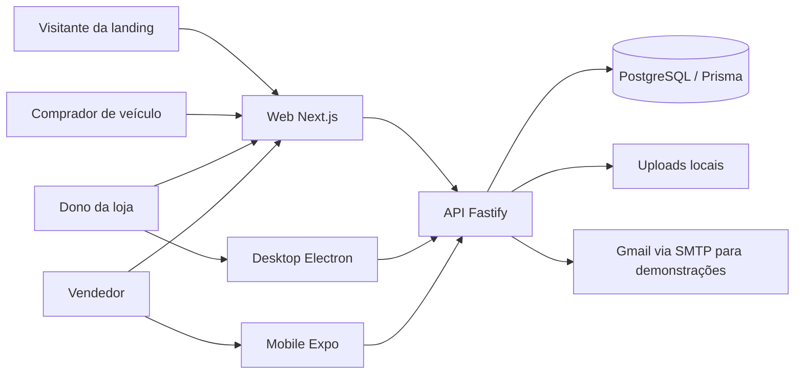

# Cartalog — documentação do projeto e próximos módulos

**Revisado em:** 02/11/2026
**Fonte:** implementação presente neste repositório.
**Legenda:** **Atual** = existe no código; **A definir** = decisão de produto ainda aberta.

## 1. Visão do produto

O Cartalog é um SaaS para lojas de veículos. Cada loja tem uma empresa (`Company`), usuários, estoque, catálogo público por subdomínio e leads. O dono administra a operação; vendedores atendem os leads. A landing institucional recebe pedidos de demonstração. Depois do contato comercial, a equipe Cartalog cria a conta inicial do dono pelo painel global.

### Superfícies

| Superfície | Público | Responsabilidade atual |
| --- | --- | --- |
| Landing web no domínio principal | Interessados | Apresentar o produto e receber pedidos de demonstração. |
| Site público em `{slug}.dominio` | Compradores | Mostrar a loja, veículos e páginas publicadas; captar leads. |
| Painel web da loja | Dono e vendedores | Dono: visão geral, veículos e acompanhamento/distribuição de leads. Vendedor: fila e atendimento. |
| Desktop Electron | Dono da loja e equipe global | Gestão de equipe, veículos, personalização e leads da loja; administração global conforme a conta usada no login. |
| Mobile React Native/Expo | Vendedores | Fila, carteira de leads, interações e mudança de status. |
| API Fastify | Todas as superfícies | Autenticação, permissões, isolamento por empresa e regras de negócio. |
| Painel global Cartalog | Equipe interna | Login separado, empresas, administradores, pedidos de demonstração, planos, assinaturas manuais e auditoria. |

### Termos que não devem ser confundidos

- **Dono da loja (`OWNER`):** usuário de uma empresa específica. Não administra outras empresas.
- **Vendedor (`SELLER`):** usuário de uma empresa específica. Atende leads na web e no mobile.
- **Dono da plataforma (`PLATFORM_OWNER`):** administra o SaaS Cartalog, em autenticação separada das lojas, inclusive os administradores globais.
- **Administrador da plataforma (`PLATFORM_ADMIN`):** usuário interno criado pelo dono da plataforma; gerencia empresas, planos e assinaturas, sem acesso à gestão de administradores.
- **Lead de venda de veículo:** contato captado no site de uma loja, salvo em `leads`.
- **Pedido de demonstração:** interessado no SaaS Cartalog, salvo em `demo_requests`; não é um lead de veículo e não cria uma empresa automaticamente.

## 2. Arquitetura atual

- [API](api/src/server.ts): Node.js, TypeScript, Fastify 5, Zod, Prisma 7 e PostgreSQL. Rotas sob `/api/v1`, documentação Swagger em `/docs` e saúde em `/health`.
- [Web](web/src/app/page.tsx): Next.js 16, React 19 e Tailwind. A raiz é a landing; o [proxy](web/src/proxy.ts) reescreve subdomínios de lojas para as páginas públicas `/{slug}`.
- [Desktop](desktop/src/App.tsx): Electron, React e Vite. A interface usa a ponte IPC exposta pelo preload; o processo principal chama a API. Não acessa o PostgreSQL diretamente.
- [Mobile](mobile/src/app/_layout.tsx): Expo Router e React Native. Usa a mesma API e os mesmos dados de leads da web.
- [Banco](api/prisma/schema.prisma): banco compartilhado entre empresas, com `company_id` nas entidades da loja. As migrações ficam em `api/prisma/migrations`.
- [Uploads](api/src/modules/uploads/uploads.service.ts): arquivos armazenados localmente em `api/uploads` e servidos pela API. Em hospedagem com múltiplas instâncias, será necessário armazenamento compartilhado.

## 3. Fluxos implementados

### 3.1 Demonstração e criação da loja

1. Interessado preenche o formulário na landing web.
2. `POST /api/v1/demo-requests` valida os dados e grava o pedido em `demo_requests`.
3. A API tenta enviá-lo por SMTP para `SALES_INBOX_EMAIL`. Se falhar, o pedido permanece no banco com `email_status=failed` e pode ser reenviado com `npm run demo:retry-emails`.
4. A equipe Cartalog conversa com o interessado e cria a empresa e o `OWNER` em `/platform`, com plano inicial opcional. O comando `npm run account:create` permanece para recuperação local.
5. O dono recebe as credenciais por um canal apropriado e passa a configurar a loja no desktop.

Não existe cadastro público de empresa: `/api/v1/auth/register` foi removido e a página web `/register` redireciona para o login. A criação pelo painel global exige uma conta da plataforma.

### 3.2 Catálogo e lead de veículo

1. Dono cadastra veículos na web ou no desktop e publica o conteúdo da loja pelo desktop.
2. Comprador visita `{slug}.localhost:3000` em desenvolvimento, ou o subdomínio equivalente em produção.
3. O frontend consulta `/api/v1/catalog`, identificando a empresa pelo host ou por `X-Tenant-Slug`.
4. O comprador envia contato por `POST /api/v1/leads/public`; o lead recebe o status aberto inicial da empresa.
5. O dono acompanha todos os leads na web ou no desktop, com filtros, responsável e histórico; pode atribuir o lead a um vendedor. Um vendedor pode assumir um lead sem responsável na fila. Somente o vendedor responsável registra interações e muda o status. `Perdido` exige motivo.

### 3.3 Sessões e permissões

- Login da loja usa apenas e-mail e senha. O e-mail identifica uma única conta de loja; a API encontra a empresa automaticamente. Senhas são armazenadas com bcrypt.
- Access token JWT e refresh token são usados nas superfícies privadas. O middleware da API consulta o usuário no banco em cada requisição protegida e verifica `isActive`, papel e `companyId`.
- O desktop aceita `OWNER`, `PLATFORM_OWNER` e `PLATFORM_ADMIN`, cada um no seu espaço; o mobile aceita somente `SELLER`. A web da loja aceita `OWNER` e `SELLER`, enquanto `/platform` atende contas globais.
- A checagem visual de menu não substitui a autorização da API. Operações de empresa, estoque, equipe e lead são protegidas também no servidor.
- A sessão do desktop guarda o refresh token da loja ou o token global criptografado pelo cofre do sistema quando o Electron oferece esse recurso; o mobile usa Expo SecureStore.

## 4. Funcionalidades atuais por perfil

| Ação | Visitante | `OWNER` | `SELLER` | Plataforma global |
| --- | :---: | :---: | :---: | :---: |
| Ver catálogo público e páginas publicadas | Sim | Sim | Sim | Sim |
| Enviar lead de veículo | Sim | Sim | Sim | — |
| Pedir demonstração do SaaS | Sim | Sim | Sim | — |
| Criar empresa e conta inicial | — | — | — | Painel global; comando interno de recuperação |
| Gerenciar vendedores | — | Desktop | — | — |
| Criar e editar veículos | — | Web e desktop | — | — |
| Personalizar a loja e criar páginas | — | Desktop | — | — |
| Ver todos os leads da sua loja e distribuir | — | Web e desktop | — | — |
| Assumir, atender e alterar status de lead | — | — | Web e mobile | — |
| Gerenciar assinaturas de todas as lojas | — | — | — | Painel global, manual |
| Ativar modo manutenção do site da sua loja | — | Desktop | — | — |

## 5. Modelo de dados atual

| Grupo | Tabelas/modelos | Uso |
| --- | --- | --- |
| Plataforma comercial | `DemoRequest` | Pedidos de demonstração e estado do envio de e-mail; não pertence a uma loja. |
| Empresa e identidade | `Company`, `SiteSettings`, `SeoSettings`, `CompanyLocation` | Dados da loja, cores, conteúdo da home, SEO e localização. |
| Pessoas | `User` | Usuários vinculados a exatamente uma empresa, com papel `OWNER` ou `SELLER` e estado ativo. |
| Conteúdo | `Banner`, `Page`, `Category`, `FeaturedVehicle` | Banners, páginas por blocos, categorias e destaques da loja. |
| Catálogo | `Brand`, `Model`, `Fuel`, `Transmission`, `Feature`, `Vehicle`, `VehicleImage`, `VehicleFeature`, `VehicleView`, `Search` | Referências globais; estoque, imagens e métricas por empresa. |
| CRM | `Lead`, `LeadStatus`, `LeadInteraction`, `LeadFollowup`, `LeadTag`, `LeadTagRelation`, `LeadVehicleInterest` | Leads, situação, responsável, histórico e relações com veículos. |

`Company` é o limite principal dos dados da loja. Marcas, modelos, combustíveis, câmbios e opcionais são referências compartilhadas. Páginas e categorias usam unicidade de slug dentro da empresa. Há tabelas para administradores globais, planos, assinaturas manuais, auditoria e histórico de manutenção. Cobranças automáticas ainda não existem.

Ter um modelo no Prisma não significa que toda a operação já tem tela ou rota. `LeadFollowup`, etiquetas e interesses adicionais de veículo, por exemplo, têm estrutura no banco, mas ainda não compõem um fluxo completo nas interfaces atuais.

## 6. Mapa da API atual

Base: `/api/v1`. O Swagger expõe o detalhamento de rotas e payloads em `/docs`. O [diagrama do banco](docs/banco-de-dados.html), o [DBML para dbdiagram](docs/banco-de-dados.dbml) e o [SQL do schema](docs/banco-de-dados.sql) também estão no repositório.

| Prefixo | Principais operações |
| --- | --- |
| `/auth` | Login da loja, renovação de token, usuário atual. |
| `/demo-requests` | `POST /` público: pedido de demonstração; grava no banco e tenta notificar por e-mail. |
| `/companies` | Dados da própria empresa; configurações, logo, categorias, banners, páginas e imagens de páginas. Escrita reservada ao `OWNER`. |
| `/vehicles` | Referências públicas; listagem privada, CRUD de veículos, imagens e capa. Escrita reservada ao `OWNER`. |
| `/leads` | Captura pública em `/public`; listagem, estatísticas, status, atribuição, assumir/devolver lead e interações. |
| `/catalog` | Home, veículos e páginas publicadas da empresa identificada pelo tenant. |
| `/dashboard` | Resumo da empresa para `OWNER`. |
| `/users` | Vendedores da empresa, ativação/desativação e troca da própria senha. |

`GET /health` verifica a conectividade com o PostgreSQL. A API de catálogo e `POST /leads/public` são distintos da landing comercial e do formulário de demonstração.

## 7. Execução local e configuração

1. Inicie PostgreSQL local ou `docker compose up -d`. O [compose](docker-compose.yml) contém PostgreSQL 16; uma instalação local compatível também serve.
2. Em `api/`, crie `.env` a partir de `.env.example`. Configure `DATABASE_URL`, duas chaves JWT distintas e, se quiser envio de e-mail, `SALES_INBOX_EMAIL`, `SMTP_USER` e `SMTP_PASS`. Rode `npm install`, `npm run db:generate`, `npm run db:migrate:prod` e `npm run dev`. Porta padrão: `3333`.
3. Em `web/`, configure `.env.local` com `NEXT_PUBLIC_API_URL=http://localhost:3333` e `NEXT_PUBLIC_BASE_DOMAIN=localhost`; rode `npm install` e `npm run dev`. Porta padrão: `3000`.
4. Em `desktop/`, crie `.env` a partir de `.env.example`, configure os endereços da API e da web e rode `npm install` e `npm run dev`.
5. Em `mobile/`, siga [mobile/README.md](mobile/README.md) e rode `npm install` e `npx expo start`. Em aparelho físico, ele deve conseguir alcançar a API pelo endereço da rede local.

Os comandos de criação interna de loja e reenvio de pedidos são executados dentro de `api/`. Não coloque senhas de banco, JWT ou Gmail no repositório. O e-mail de demonstração só é entregue de fato quando o SMTP está configurado e acessível.

Para a apresentação no Windows, veja [o roteiro de execução](APRESENTACAO.md) e o script [iniciar-demo-windows.cmd](iniciar-demo-windows.cmd).

## 8. Painel global implementado

A plataforma usa identidades próprias em PlatformUser. O login em /platform/login ou no desktop recebe e-mail e senha; a sessão global usa um JWT com chave derivada, emissor, audiência e escopo próprios. Um token global não autoriza as rotas da loja. O primeiro proprietário global é criado ou atualizado pelo comando interativo npm run platform:bootstrap em api/. A senha não fica no repositório.

O painel em /platform permite:

- Ver empresas, assinaturas ativas, planos e pedidos de demonstração.
- Criar uma empresa e a conta OWNER, associando um plano inicial opcional.
- Criar e ativar/desativar planos, definir preço em centavos e período mensal ou anual.
- Definir manualmente o plano, estado, data final do período e observação de cada assinatura.
- Ver pedidos de demonstração recebidos.
- Criar, ativar e desativar administradores globais e consultar auditoria, ações reservadas ao PLATFORM_OWNER.

As rotas ficam em /api/v1/platform. O registro público de administradores não existe. As senhas são armazenadas com bcrypt. O painel não acessa leads de uma loja nem entra na sessão de seus usuários.

## 9. Assinaturas manuais

Plan e CompanySubscription representam a oferta e o vínculo comercial. Os estados disponíveis são trialing, active, past_due, suspended e canceled. Alterações feitas pelo painel global geram PlatformAuditLog. A situação ainda não bloqueia automaticamente o catálogo, o login ou as ações da loja: a política de carência e suspensão precisa ser definida antes dessa regra. Não há integração com gateway, cobrança automática ou webhooks.

## 10. Manutenção do site da loja

O dono aciona a opção na tela de configurações do desktop. A API oferece GET e PATCH em /api/v1/companies/settings/maintenance, exigindo OWNER e usando o companyId da sessão. Cada alteração é registrada em SiteMaintenanceEvent. Vendedores não têm permissão.

O endpoint /api/v1/catalog/status continua disponível com nome, logo e mensagem da loja. Quando a manutenção está ligada, os demais endpoints de catálogo e o formulário público de leads respondem 503. O frontend Next mostra a página de manutenção em vez do conteúdo da loja. A página HTML do Next ainda responde 200; a API pública responde 503 com Retry-After e X-Robots-Tag. URLs diretas de uploads continuam acessíveis.

O controle aparece somente no desktop. A API diferencia OWNER de SELLER, mas o token do dono pode ser usado em outras interfaces; autenticar o dispositivo Electron separadamente seria necessário para impor uma exclusividade técnica do desktop.

## 11. Operação e pendências

1. Em api/, execute npm run db:generate e npm run db:migrate:prod.
2. Execute npm run platform:bootstrap em um terminal interativo para criar ou trocar o e-mail e a senha do proprietário global.
3. Inicie API e web e acesse /platform/login no domínio principal. No desenvolvimento local, use http://localhost:3000/platform/login.
4. Crie um plano e, depois, uma empresa pelo painel. Entregue ao dono as credenciais iniciais por um canal seguro. Ele entra no desktop e cadastra vendedores.

Para testes locais, o instalador do desktop usa a API padrão em http://127.0.0.1:3333 e a web em http://localhost:3000. A build Windows está em desktop/release/.

Pendências antes de uma operação comercial completa: política de suspensão por inadimplência, integração de pagamento, recuperação de senha por e-mail, autenticação multifator para contas globais, assinatura digital do instalador e configuração de endpoints de produção no desktop. A entrega de pedidos de demonstração por Gmail depende das variáveis SMTP no ambiente.

## 12. Arquivos de referência

- [Visão geral](README.md), [API](api/src/server.ts), [schema Prisma](api/prisma/schema.prisma) e [migrações](api/prisma/migrations).
- [Autenticação](api/src/modules/auth/auth.service.ts), [middleware de autorização](api/src/shared/middlewares/auth.middleware.ts) e [identificação da loja](api/src/shared/middlewares/tenant.middleware.ts).
- [Landing](web/src/app/page.tsx), [proxy de subdomínios](web/src/proxy.ts) e [catálogo público](api/src/modules/catalog/catalog.routes.ts).
- [Desktop](desktop/README.md), [web](web/README.md) e [mobile](mobile/README.md).
