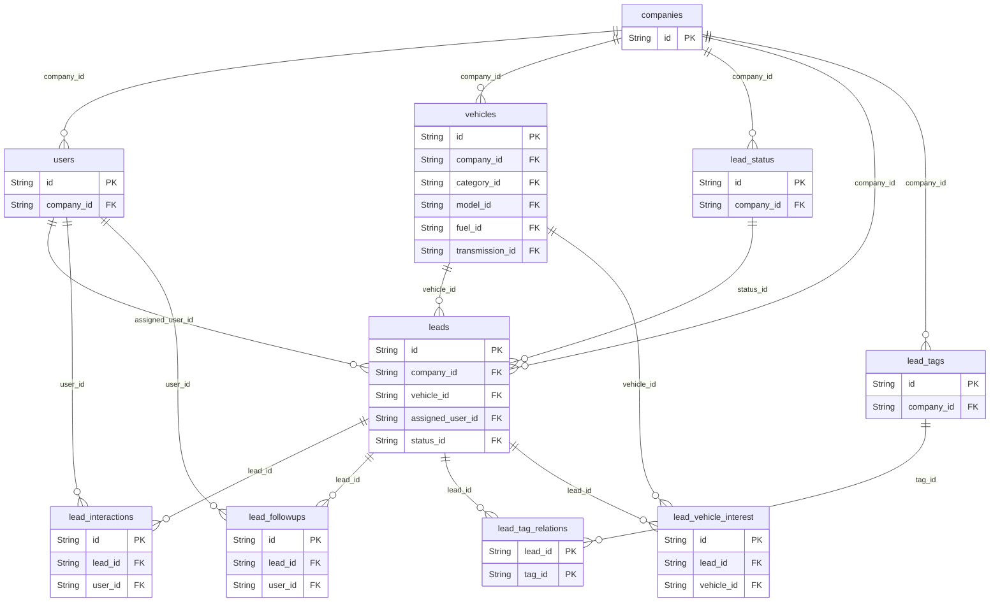
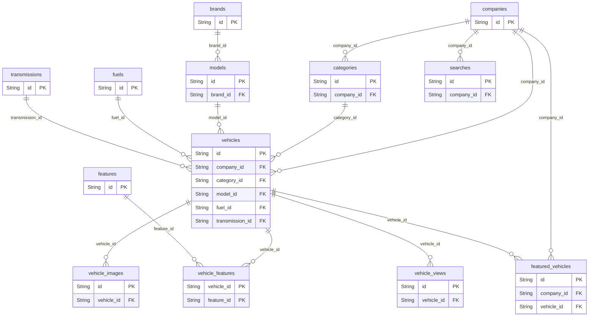
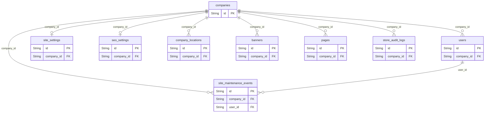
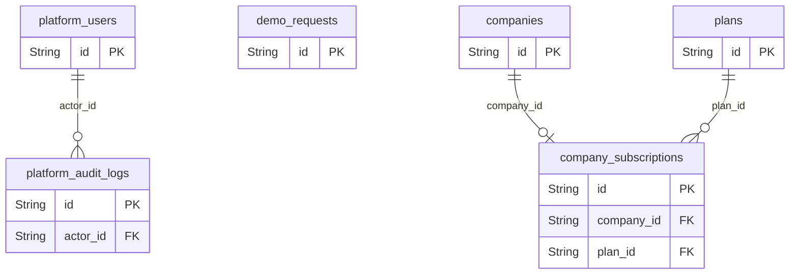

# Banco de dados do Cartalog

Fonte: [schema Prisma](../api/prisma/schema.prisma). Abra o [explorador visual](banco-de-dados.html) para seguir cada chave estrangeira, copie o [DBML para dbdiagram](banco-de-dados.dbml) ou consulte o [SQL PostgreSQL](banco-de-dados.sql).

O SQL representa a estrutura de um banco vazio. Para atualizar bancos existentes, use as migrações em `api/prisma/migrations`.

## Leads e atendimento

Distribuição, vendedor responsável, histórico e interesses.

## Veículos e catálogo

Estoque, marca, modelo, fotos e características.

## Lojas e site

Dono, equipe, aparência, páginas e manutenção.

## Plataforma

Administração global, assinaturas e demonstrações.

## Regenerar

Na pasta `api`, execute `npm run docs:db` para atualizar o SQL, esta referência e a página visual após alterar o schema Prisma.
